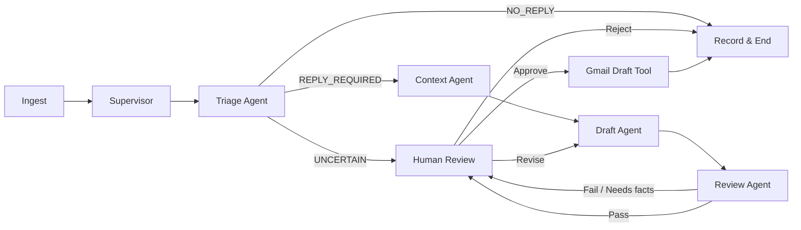
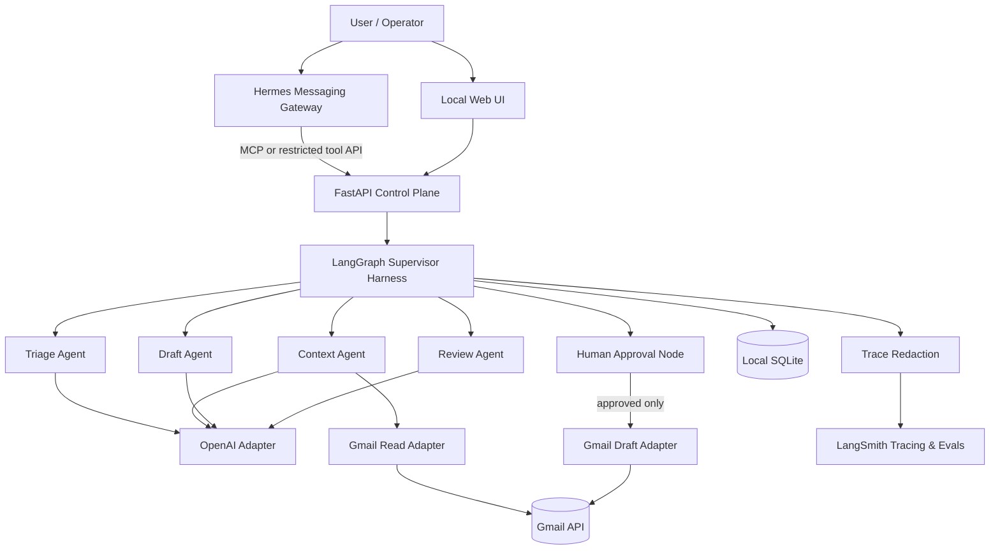

# Gmail Reply Triage and Drafting Multi-Agent System — PRD

- Status: Draft v0.1
- Date: 2026-09-14
- Baseline implementation: Python 3.11–3.13, FastAPI, LangGraph 1.x, LangSmith, OpenAI, Hermes Agent Gateway
- Product principles: no automatic sending, least privilege, human approval, observable multi-agent design

## 1. Executive Summary

### Problem Statement

Users spend repeated time in their Gmail inbox picking out the emails that need a reply and writing replies that fit the context. A single-agent approach bundles classification, drafting and policy checks into one responsibility, which makes errors hard to diagnose and makes it hard to add specialist agents later.

### Proposed Solution

Build a local-first system with the Hermes Agent Gateway as the operator touchpoint and FastAPI as the application boundary, in which a LangGraph Supervisor coordinates specialist agents: `triage → context gathering → drafting → quality and safety review → human approval`. Only drafts are saved to Gmail; there is no send permission and no automatic sending path. LangSmith provides tracing, offline evaluation and error diagnosis for every node.

Roles are separated so that Hermes's own agent loop and LangGraph do not compete. The Hermes Gateway carries user commands and status notifications, and LangGraph stays the single source of truth for the Gmail workflow. The two layers connect through MCP or a restricted FastAPI tool adapter.

### Success Criteria

1. The overall average of human 1–5 ratings for reply-draft suitability is **4.0 or higher**.
2. During testing and demos, Gmail `send`-family API calls and automatic sends number **zero**.
3. In every run on the validation dataset, the Supervisor and every specialist agent node that ran are recorded in LangSmith traces **100%** of the time.
4. Raw OAuth tokens or API keys appear in logs, LangSmith traces, error responses or the repository **zero** times.
5. Demonstrate extensibility by adding one new specialist agent through the agent registry and graph routing only, without changing the core logic of existing agents.

## 2. User Experience & Functionality

### User Personas

- **Email user:** an individual who wants to quickly review the emails that need a reply and safe drafts for them.
- **Operator/developer:** someone who diagnoses the Supervisor's decision path, tool calls, failure causes, cost and latency.
- **Evaluator:** someone who scores classification and draft quality against consistent criteria and checks for regressions.

### User Flow

1. The user asks for a Gmail sync from the local web UI or a channel connected to Hermes.
2. The system checks the OAuth session and fetches the threads to process within the allowed Gmail read scope.
3. The Supervisor passes each email to the Triage Agent.
4. The Triage Agent returns one of `REPLY_REQUIRED`, `NO_REPLY` or `UNCERTAIN`, with confidence, reasons and priority.
5. For `REPLY_REQUIRED` or `UNCERTAIN`, the Context Agent assembles only the thread context needed.
6. The Draft Agent writes a subject and body based on the user's tone policy and the email context.
7. The Review Agent checks factual accuracy, whether requests are met, privacy, prohibited wording, over-promising and the effect of prompt injection.
8. Results that pass appear in the UI review queue. Results that fail or are uncertain are routed to human review with the reason.
9. When the user approves, the result is saved as a Gmail Draft. The user can edit or reject, and in no case does the system send email.
10. Run traces and structured evaluation results are recorded in LangSmith after sensitive information is removed.

### User Stories

#### US-1: Classify emails that need a reply

As an email user, I want emails classified as needs reply / no reply / uncertain so that I don't miss important email and spend less time reviewing.

**Acceptance Criteria**

- Output follows a verifiable schema that includes `label`, `confidence`, `reason_codes`, `priority` and `language`.
- If `confidence` is below a configurable threshold, the email is routed to `UNCERTAIN` automatically.
- Can be evaluated on a reference dataset that includes newsletters, automated notifications, receipts, calendar invitations, direct questions, requests and emails with deadlines.
- Instructions contained in an email body are treated as data and cannot change system or developer policy.

#### US-2: Context-aware reply drafts

As an email user, I want reply drafts that reflect the relevant thread context so that I can finish replies with minimal edits.

**Acceptance Criteria**

- Drafts use the language of the original email by default.
- Drafts include a self-check result showing that no key item the sender asked for was missed.
- Unknown facts, dates, prices or commitments are not invented; they are marked `[needs confirmation]` or turned into structured questions.
- The average human-rated draft suitability is 4.0/5.0 or higher.
- Generated results are shown in the UI first and nothing is written to Gmail before approval.

#### US-3: Save to Gmail Draft after human approval

As an email user, I want to review, edit and approve a draft before it is saved as a Gmail Draft so that I keep final control.

**Acceptance Criteria**

- Three actions are offered: approve, edit then approve, reject.
- Gmail Draft creation runs only after an explicit approval event.
- The Gmail `send` method and the `gmail.send` scope are neither implemented nor requested.
- Retries of the same approval event use an idempotency key to prevent duplicate drafts.
- Only the saved draft's Gmail identifier and processing state are recorded in the local state store.

#### US-4: LLMOps evaluation and diagnosis

As an operator, I want to compare each agent's decisions and quality scores in traces so that I can reproduce failure causes and regressions.

**Acceptance Criteria**

- LangSmith traces carry the tags `workflow_id`, `email_case_id`, `graph_version`, `prompt_version`, `model` and `agent_name`.
- Raw email addresses, OAuth tokens, API keys and raw attachments are not sent to LangSmith.
- Classification accuracy evaluation, an LLM-as-judge for draft suitability, and format and security code evaluations can be viewed in the same experiment.
- Failed cases can be de-identified, added to a regression dataset and compared with earlier experiments.
- Per-node latency, token usage, errors and retry counts are visible.

#### US-5: Extending with specialist agents

As a developer, I want to register new specialist agents under the Supervisor so that I can add capabilities such as scheduling, CRM lookup and attachment analysis step by step.

**Acceptance Criteria**

- Every specialist agent declares its name, input/output schema, allowed tools, timeout and retry policy.
- The Supervisor calls only agents registered in the registry.
- A per-agent tool allowlist is enforced, and the Draft Agent cannot call Gmail write tools directly.
- Demonstrate the extension procedure by adding a sample `CalendarIntentAgent` that is a no-op or fixture-based.

### Non-Goals

- Automatic email sending and any Gmail change without user approval.
- Backfilling the whole mailbox, multi-tenancy for large organizations, an admin console.
- Attachment OCR and malware analysis, and real write integrations with external CRMs or calendars.
- Making legal, financial or medical decisions on the user's behalf.
- Replacing Hermes's internal agent loop with LangGraph wholesale, or forking the Hermes repository.
- Supporting every messaging platform at the start. The MVP validates only the local web UI and one chosen Hermes channel.

## 3. AI System Requirements (If Applicable)

### Multi-Agent Responsibilities

| Component | Responsibility | Allowed tools | Prohibited |
|---|---|---|---|
| Supervisor | State transitions, agent selection, interrupts and retries, routing to human approval | Agent registry, state store | Sending email, free-form tool execution |
| Triage Agent | Classify whether a reply is needed, priority, reason codes | Read de-identified mail and headers | Gmail writes, internet search |
| Context Agent | Summarize thread context and extract open requests | Gmail read adapter | Creating drafts, external transmission |
| Draft Agent | Generate structured reply drafts | OpenAI model | Calling the Gmail API directly, inventing facts |
| Review Agent | Check suitability, accuracy, safety and policy | Policy rules, optional judge model | Editing the original, Gmail writes |
| Human Approval Node | Collect the user's approve, edit or reject decision | UI events | Assuming approval |
| Gmail Draft Tool | Save approved results as drafts | Gmail drafts.create | Gmail send, modifying arbitrary messages |

### Supervisor Routing Contract

The Supervisor state includes at least these fields:

```text
workflow_id
email_case_id
message_metadata
sanitized_content
triage_result
thread_context
draft
review_result
human_decision
gmail_draft_id
errors[]
audit_events[]
```

Default graph transitions:



### Tool Requirements

- **Gmail Read Adapter:** retrieves message and thread lists and only the bodies needed, and converts them to an internal standard schema.
- **Gmail Draft Adapter:** calls `users.drafts.create` only for requests that carry an approval token.
- **OpenAI Model Adapter:** central configuration of model name, timeout, retry, structured output and cost metadata.
- **Hermes MCP/FastAPI Adapter:** limits Hermes commands to creating LangGraph runs, checking status and approval events.
- **PII Redaction Tool:** masks email addresses, phone numbers, signatures, tokens and user-defined sensitive patterns before traces are sent.
- **Policy Validator:** deterministically checks the no-auto-send rule, tool allowlists, output schemas and approval tokens.
- **State Store:** the MVP uses local SQLite, with a configured retention period and deletion job for raw email.

### Evaluation Strategy

Uses LangSmith's dataset → evaluator → experiment → analysis flow.

#### Dataset

- Start with at least 50 de-identified email cases.
- Class balance: at least 15 each of `REPLY_REQUIRED`, `NO_REPLY` and `UNCERTAIN`, with the rest edge cases.
- Use metadata splits for language, automated notifications, direct questions, multiple requests, dates and deadlines, long threads and prompt-injection phrasing.
- Raw Gmail content is not uploaded to a LangSmith dataset without prior consent.

#### Evaluators

1. **Classification evaluator:** agreement between reference and actual labels, plus per-class precision/recall/F1. Release-gate numbers are set after initial labeling (`TBD`).
2. **Draft suitability judge:** scores 1–5 on a rubric of relevance, request coverage, tone, clarity and accuracy. An average of 4.0 or higher is a required gate.
3. **Safety/code evaluator:** deterministically checks for automatic-send attempts, prohibited scopes, token/PII exposure and schema errors; the failure tolerance is zero.
4. **Trajectory evaluator:** checks that the Supervisor did not call disallowed agents or tools.
5. **Operational evaluator:** records per-node latency, token usage and retries. Cost and latency release thresholds are set after the first baseline experiment (`TBD`).

#### Experiment Policy

- Prompt, model and graph changes are compared with the baseline on the same fixed test split.
- Experiment metadata records the model, prompt version, graph version and dataset version.
- Cases with draft suitability < 4, safety evaluation failures or exceptions are added to the regression split after de-identification review.
- In online demos, evaluators run on sampled traces using de-identified data and structured results instead of raw content.

## 4. Technical Specifications

### Architecture Overview



#### Boundary Decision

- The Hermes Gateway is used for platform connections, sessions and passing operator commands.
- LangGraph owns orchestration of the email workflow, checkpoints, human-in-the-loop and agent extension.
- When Hermes calls LangGraph, it uses restricted tool contracts such as `scan_inbox`, `get_run_status` and `review_draft` instead of passing arbitrary prompts.
- Hermes's own AIAgent does not own Gmail tools directly, which blocks bypass execution.
- Before implementation, run a short compatibility spike covering Hermes MCP calls, authentication, timeouts and result delivery. If it fails, limit Hermes to a CLI/status-notification layer and use FastAPI directly.

### Recommended Stack

- Python 3.11–3.13. The current local Python 3.14 carries compatibility risk for some dependencies, so the project runtime is pinned to 3.12 or 3.13.
- FastAPI + Uvicorn, Pydantic v2.
- `langchain>=1.0,<2.0`, `langchain-core>=1.0,<2.0`, `langgraph>=1.0,<2.0`, `langsmith>=0.3.13`.
- The official OpenAI SDK and the dedicated `langchain-openai` integration package.
- Google API Python Client and the OAuth client library.
- A SQLite-based LangGraph checkpointer and application state store.
- `uv` and a lockfile so the verified versions are reproducible.

Python was chosen over TypeScript as the default because the Hermes Agent core runtime and install path are Python-centric, and there are ample LangGraph and LangSmith examples for evaluation and local data processing. If the UI grows into a separate React app, only the frontend can be split out in TypeScript.

### Integration Points

#### Hermes Agent Gateway

- `hermes gateway` serves as the ingress/egress for user commands and status notifications.
- FastAPI/LangGraph functions are exposed through Hermes's MCP integration or plugin/tool registration.
- Allowed commands are limited to inbox scan, result lookup and approve/reject.
- Hermes allowlists and admin/regular user permissions are enabled.

#### Gmail API

- Use the OAuth Authorization Code flow, with PKCE S256 and `state` verification where the client type allows.
- Scopes are designed as the `gmail.readonly` + `gmail.compose` combination.
- The broad `https://mail.google.com/`, `gmail.modify` and `gmail.send` scopes are not requested in the MVP.
- Draft creation uses Gmail `users.drafts.create`.
- The local MVP uses manual refresh or rate-limited polling. Gmail push notifications/Pub/Sub are a v1.1 candidate.

#### OpenAI

- Model, temperature, structured output schema and timeout are configured centrally.
- The model must be swappable through environment variables or a config file, not hard-coded in prompt code.
- The API key is read from environment variables or the OS secret store and never printed in the UI, logs or traces.

#### LangSmith

- Separate projects for development, evaluation and demos.
- Tracing can be turned on and off per environment, with a fail-closed policy: if redaction fails, the trace is not sent.
- Datasets and evaluators record versions, and experiments are compared on the same test split.

### API Surface (MVP)

| Method | Path | Purpose |
|---|---|---|
| `POST` | `/api/runs/scan` | Create a classification run with a restricted Gmail query |
| `GET` | `/api/runs/{run_id}` | Get per-node status and results |
| `GET` | `/api/review-queue` | List items awaiting human review |
| `POST` | `/api/drafts/{case_id}/decision` | Submit an edit, approve or reject event |
| `POST` | `/api/drafts/{case_id}/persist` | Save an approved draft as a Gmail Draft |
| `GET` | `/health` | Check process and dependency health |

Every write endpoint requires CSRF protection, session authentication, an idempotency key and an audit event. `/persist` returns `409` or `403` if there is no valid approval event.

### Security & Privacy

1. **Least privilege:** request only Gmail read and draft scopes; exclude the send scope.
2. **Token storage:** keep the refresh token in the OS keychain or an encrypted secret store, never in the repository, localStorage, plain-text SQLite or logs.
3. **OAuth hardening:** redirect URI allowlist, PKCE S256, state verification, short session lifetime, and re-authentication and revocation procedures.
4. **Prompt-injection defense:** tag email bodies and attachment text as untrusted data and ignore instructions in the body to use tools or change policy.
5. **Tool isolation:** per-agent allowlists. The Gmail Draft Tool can be invoked only indirectly, by the Supervisor and the approval node.
6. **Human-in-the-loop:** an explicit approval event is required before a draft is saved, and sending is removed from the code, the scopes and the UI.
7. **Trace privacy:** send LangSmith only de-identified input, structured results and hash-based case ids. Raw attachments are never sent.
8. **Data retention:** a proposed default of 24 hours for the local raw-email cache, configurable by the user. The final value is set in security review (`TBD`).
9. **Audit:** record approvals, rejections, Gmail Draft creation, OAuth re-authentication and policy violations as append-only audit events.
10. **Network boundary:** local services bind to `127.0.0.1` by default. External exposure is prohibited until separate authentication and TLS are designed.

### Reliability and Failure Handling

- Apply timeouts and exponential backoff to Gmail, OpenAI and LangSmith calls, and require idempotency for write retries.
- A LangSmith outage does not stop core classification and drafting; redacted traces are kept in a bounded local queue and resent.
- An expired Gmail authorization is shown to the user as a re-authentication state, and the run is kept resumable rather than marked failed.
- Each node returns structured errors to the Supervisor, with a maximum retry count to prevent infinite loops.
- The same Gmail message or thread is not processed twice, using a processing fingerprint.

### Functional Verification Plan

- Unit tests: schemas, routing, scope checks, redaction, idempotency, the policy validator.
- Graph tests: `NO_REPLY`, `UNCERTAIN`, review failure, user edits, approval and OAuth-expiry branches.
- Integration tests: verify only reads and draft creation on a Gmail sandbox/test account.
- Security tests: malicious instructions in email, token leaks in logs, approval bypass, duplicate persist requests.
- E2E tests: from a Hermes command or the local UI, scan → review → confirm the Gmail Draft.
- LLMOps demo: compare a baseline and a changed prompt on the same dataset and diagnose failed traces.

## 5. Risks & Roadmap

### Phased Rollout

#### MVP — local validation and demo

- Hermes↔FastAPI/LangGraph MCP compatibility spike.
- OAuth on a Gmail test account with minimal scopes.
- Supervisor, Triage, Context, Draft, Review and Human Approval nodes.
- Local review UI and saving to Gmail Draft.
- LangSmith tracing, a 50-case dataset, the draft suitability evaluator and the security evaluator.
- Demonstrate zero automatic sends and an average draft suitability of 4.0 or higher.

#### v1.1 — operational hardening

- Gmail push notifications/Pub/Sub or a reliable scheduler.
- Online evaluator sampling and an automatic candidate queue for failed cases.
- Per-user tone profiles with versioning.
- Set cost and latency budgets and alert thresholds.
- Review attachment metadata classification and sandboxed processing.

#### v2.0 — specialist agent expansion

- Registry-based expansion with CalendarIntentAgent, CRMContextAgent, AttachmentAgent and others.
- Role-based access control for organizations, tenant isolation, a central secret manager.
- Policy-specific approval steps and dual approval for high-risk email.
- Multi-model routing and quality/cost optimization.

### Technical Risks

| Risk | Impact | Mitigation |
|---|---|---|
| Overlapping orchestration between Hermes's internal AIAgent and LangGraph | State mismatch, duplicate execution | Limit Hermes to ingress/egress and fix the boundary after the MCP contract spike |
| Gateway/plugin API changes in Hermes updates | Broken integration | Adapter layer, version pinning, contract tests, fallback FastAPI UI |
| Gmail restricted/sensitive scope review and OAuth configuration errors | Authentication failures, delayed deployment | MVP based on test users, minimal scopes, redirect URI checks, step-by-step OAuth checklist |
| Prompt injection via email | Policy bypass, data leakage | Untrusted-content boundary, tool allowlists, deterministic policy validator, attack dataset |
| LLM misclassifying whether a reply is needed | Missed important email | `UNCERTAIN` path, confidence threshold, per-class recall evaluation, human review |
| Drafts with inaccurate statements or over-promising | Loss of user trust | Review Agent, needs-confirmation markers, rubric evaluation, mandatory approval |
| Sensitive email content sent to LangSmith | Privacy breach | Fail-closed redaction, no raw content sent, de-identified datasets, trace payload tests |
| Python 3.14 dependency compatibility | Install or runtime failures | Pin the project to Python 3.12/3.13, lockfile, CI matrix |
| LLM-as-judge bias | Distorted quality metrics | Human-rated samples, a fixed rubric, recorded judge versions, deterministic evaluations alongside |

### Open Decisions

- The first channel to use in Hermes: CLI, browser, Telegram, etc. (`TBD`).
- OpenAI model name and the allowed cost/latency budget (`TBD`).
- Release criteria for classification precision/recall/F1 (`TBD`, set after the first labeling baseline).
- The final retention period for the local raw-email cache (`TBD`).
- Whether the organization's privacy policy approves using LangSmith Cloud (`TBD`).

### Source References

- [Hermes Agent repository](https://github.com/NousResearch/hermes-agent)
- [Hermes Messaging Gateway](https://hermes-agent.nousresearch.com/docs/user-guide/messaging)
- [Hermes Architecture](https://hermes-agent.nousresearch.com/docs/developer-guide/architecture)
- [Hermes Security](https://hermes-agent.nousresearch.com/docs/user-guide/security)
- [Hermes MCP integration](https://hermes-agent.nousresearch.com/docs/user-guide/features/mcp)
- [LangSmith Evaluation](https://docs.langchain.com/langsmith/evaluation)
- [LangSmith Evaluation Quickstart](https://docs.langchain.com/langsmith/evaluation-quickstart)
- [Gmail users.drafts.create](https://developers.google.com/workspace/gmail/api/reference/rest/v1/users.drafts/create)
